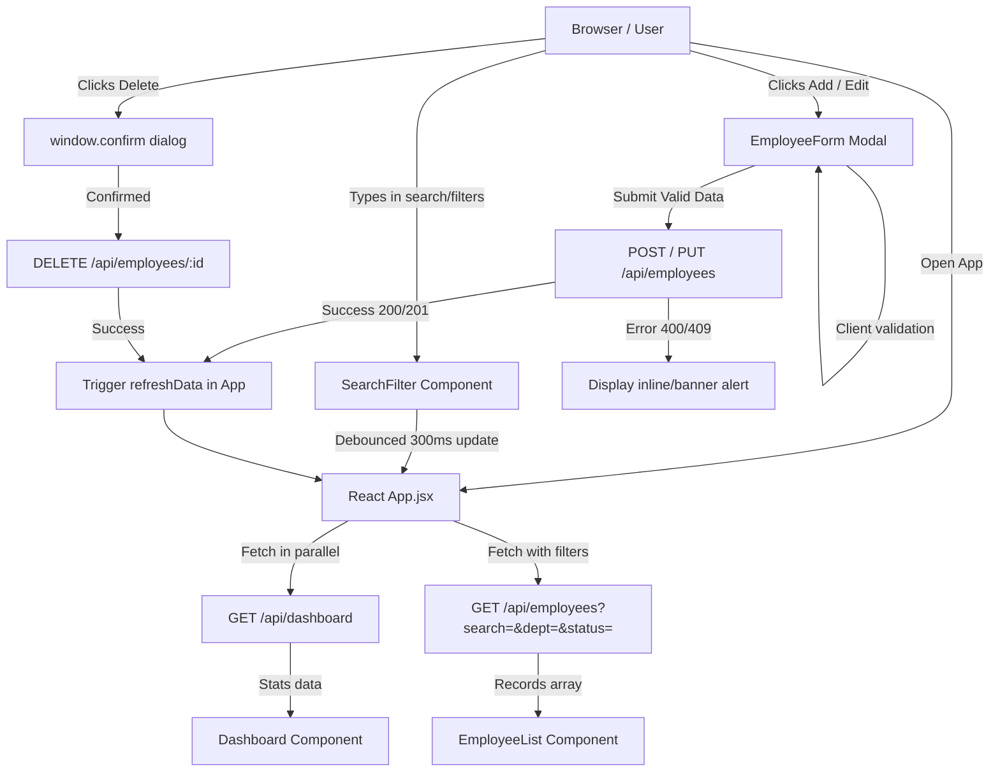

# Project Reference & Architecture Guide: Employee Management System (EMP-APJ)

> **Purpose**: This file serves as the canonical reference for the internal architecture, workflows, data contracts, and modification history of this project. Any future changes should be recorded here so the application can be understood and updated without needing to re-scan the entire codebase.

---

## 1. Project Overview & Tech Stack

| Layer | Technology | Justification |
|---|---|---|
| **Frontend** | React 18, Vite | Component modularity, reactive state updates, sub-second HMR dev server |
| **Backend API** | Node.js, Express.js | Standard RESTful routing, flexible middleware chain, non-blocking I/O |
| **Database** | SQLite via `sql.js` | Zero-dependency, pure WebAssembly/JS SQLite engine; no native C++ compiler needed on Windows; atomic persistence to disk via export buffer |
| **API Client** | Native `fetch` with error wrapper | Zero additional bundle weight, explicit status code & error message unwrapping |
| **Backend Tests** | Jest 29, Supertest 6 | Complete integration tests with in-memory SQLite database (`:memory:`) |
| **Frontend Tests**| Vitest, React Testing Library, jsdom | Fast test execution matching Vite config, DOM simulation, user-centric queries |
| **VCS** | Git | Feature branching, clean commits, full revision traceability |

---

## 2. Directory & File Structure

```
EMP-APJ/
├── .gitignore                      # Ignore node_modules, .db files, build artifacts
├── README.md                       # User-facing guide with setup and run instructions
├── PROJECT_REFERENCE.md            # [THIS FILE] Technical reference & architecture manual
│
├── backend/
│   ├── package.json                # Express, sql.js, cors, jest, supertest
│   ├── jest.config.js              # Jest configuration targeting tests/
│   ├── employees.db                # Persisted SQLite database file (created on runtime)
│   ├── src/
│   │   ├── app.js                  # Express application factory createApp(db) with CORS & JSON
│   │   ├── db.js                   # sql.js initialization, table migration, wrapper with auto-save
│   │   ├── server.js               # Application entry point: initializes db and starts listener
│   │   ├── middleware/
│   │   │   └── validation.js       # Field-level validators for POST & PUT employee payloads
│   │   └── routes/
│   │       ├── dashboard.js        # GET /api/dashboard (total, active, inactive counters)
│   │       └── employees.js        # CRUD + Search (LIKE) + Department/Status filtering
│   └── tests/
│       ├── dashboard.test.js       # 6 integration tests for dashboard metrics calculation
│       └── employees.test.js       # 28 integration tests for CRUD, filtering, validation, 409 conflict
│
└── frontend/
    ├── package.json                # React 18, Vite, Vitest, Testing Library
    ├── vite.config.js              # Port 5173, dev proxy /api -> http://localhost:5000
    ├── vitest.config.js            # Vitest runner with jsdom environment
    ├── index.html                  # HTML entry point with viewport configuration
    ├── src/
    │   ├── main.jsx                # React root bootstrap
    │   ├── App.jsx                 # Central state manager: loads dashboard & employee lists, coordinates modals
    │   ├── App.css                 # Clean, responsive CSS with CSS variables, tables & badges
    │   ├── components/
    │   │   ├── Dashboard.jsx       # 3 stat cards: Total, Active, Inactive employees
    │   │   ├── SearchFilter.jsx    # Debounced text search (300ms) + Department + Status dropdowns
    │   │   ├── EmployeeList.jsx    # Data table with edit/delete triggers, status badges, empty states
    │   │   └── EmployeeForm.jsx    # Add/Edit modal form with client validation & API error alerts
    │   ├── services/
    │   │   └── api.js              # HTTP client abstraction (fetch, error extraction)
    │   └── tests/
    │       ├── setup.js            # Matchers setup & window.confirm mock
    │       ├── Dashboard.test.jsx  # Tests stat card rendering
    │       ├── EmployeeForm.test.jsx# Tests form rendering, validation trigger, error displays
    │       └── EmployeeList.test.jsx# Tests table rendering, delete callback, empty state
```

---

## 3. Database Schema

### Table: `employees`

```sql
CREATE TABLE IF NOT EXISTS employees (
  id INTEGER PRIMARY KEY AUTOINCREMENT,
  name TEXT NOT NULL,
  email TEXT NOT NULL UNIQUE,
  department TEXT NOT NULL,
  designation TEXT NOT NULL,
  status TEXT NOT NULL DEFAULT 'active' CHECK(status IN ('active', 'inactive')),
  created_at TEXT DEFAULT (datetime('now')),
  updated_at TEXT DEFAULT (datetime('now'))
);
```

### Persistence Mechanism:
`sql.js` initializes from `employees.db` on disk if present. Every `.run()` statement (INSERT, UPDATE, DELETE) executes `wrapper.save()`, writing the SQLite binary buffer atomically to `employees.db`. In tests, passing `':memory:'` bypasses disk writes for maximum speed and complete isolation.

---

## 4. API Specification & Data Contracts

Base URL: `http://localhost:5000/api`

### 4.1 Dashboard
- **`GET /api/dashboard`**
  - **Description**: Returns live employee count metrics.
  - **Response 200**:
    ```json
    {
      "total": 5,
      "active": 4,
      "inactive": 1
    }
    ```

### 4.2 Employees CRUD & Search
- **`GET /api/employees`**
  - **Query Parameters**:
    - `search` *(string, optional)*: Case-insensitive substring match on `name` (`%search%`).
    - `department` *(string, optional)*: Exact match on `department`.
    - `status` *(string, optional)*: Match on `'active'` or `'inactive'`.
  - **Response 200**: Array of employee objects ordered by `created_at DESC`.

- **`GET /api/employees/:id`**
  - **Response 200**: Single employee record.
  - **Response 404**: `{"error": "Employee not found"}`

- **`POST /api/employees`**
  - **Request Body**:
    ```json
    {
      "name": "Jane Doe",
      "email": "jane.doe@company.com",
      "department": "Engineering",
      "designation": "Staff Engineer",
      "status": "active" // optional, defaults to 'active'
    }
    ```
  - **Validation**:
    - `name`: 2-100 characters, non-empty
    - `email`: Valid RFC email regex, converted to lowercase, unique
    - `department`: Required
    - `designation`: Required
    - `status`: Must be `'active'` or `'inactive'`
  - **Response 201**: Created employee record with `id`, `created_at`, `updated_at`.
  - **Response 400**: `{"error": "Validation failed", "details": ["..."]}`
  - **Response 409**: `{"error": "An employee with this email already exists"}`

- **`PUT /api/employees/:id`**
  - **Request Body**: Same fields as POST.
  - **Validation**: Same as POST, excluding the target employee from duplicate email conflict check.
  - **Response 200**: Updated employee object with updated `updated_at`.
  - **Response 404**: `{"error": "Employee not found"}`
  - **Response 409**: Duplicate email exists on another record.

- **`DELETE /api/employees/:id`**
  - **Response 200**: `{"message": "Employee deleted successfully"}`
  - **Response 404**: `{"error": "Employee not found"}`

---

## 5. Application Workflow & State Architecture



### Key Workflow Highlights:
1. **Zero Out-of-Sync Counters**: When an employee is added, edited, or deleted, `refreshData()` triggers both `fetchDashboard()` and `fetchEmployees()` concurrently so stats always match the database truth.
2. **Double-Layer Validation**:
   - Client-side: Instant feedback before submission (empty inputs, invalid email pattern).
   - Server-side: Express middleware sanitizes, validates types, and rejects duplicates.
3. **Safe Search Debouncing**: 300ms debounce on search input prevents query spamming on every keystroke.
4. **Destructive Action Safeguard**: Deletion requires explicit user confirmation via `window.confirm`.

---

## 6. Testing Strategy & Coverage

- **Backend (Jest + Supertest)**: 34 tests covering happy path, validation failures, unique constraint violations, filter combinations, 404s, and count arithmetic.
- **Frontend (Vitest + React Testing Library)**: 15 tests verifying stat cards, table rendering, empty state handling, form validation messages, and submission triggers.
- **Total Test Suite**: 49 automated tests passing.

---

## 7. Change Log & Revision History

| Date | Author | Description of Change | Rationale / Notes |
|---|---|---|---|
| 2026-10-26 | System | Initial full-stack implementation | Express API, React frontend, SQLite persistence, test suites |
| 2026-10-26 | System | Switched from `better-sqlite3` to `sql.js` | Windows environment compatibility without requiring Visual Studio C++ build tools |
| 2026-10-26 | System | Added automated database saving on `.run()` | Guarantees atomic write of `employees.db` to disk on all mutations |
| 2026-10-26 | System | Fixed heading query collision in `EmployeeForm.test.jsx` | Use `getByRole('heading', { name: 'Add Employee' })` to avoid button text collision |
| 2026-10-26 | System | Fixed case-sensitivity validation for `status` and `id` mapping | Backend now normalizes `status` case-insensitively ('Active' -> 'active'); Frontend maps `id || _id` and displays detailed server validation errors |

