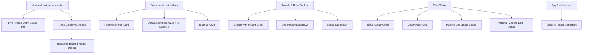

# Project Reference & Architecture Guide: Employee Management System (EMP-APJ)

> **Purpose**: This file serves as the canonical reference for the internal architecture, workflows, data contracts, and modification history of this project. Any future changes should be recorded here so the application can be understood and updated without needing to re-scan the entire codebase.

---

## 1. Project Overview & Tech Stack

| Layer | Technology | Justification |
|---|---|---|
| **Frontend** | React 18, Vite | Modern component architecture, reactive state updates, sub-second HMR dev server |
| **Frontend UI/UX** | Modern SaaS Design System | Clean slate & indigo aesthetic, backdrop-blur modal dialog, avatar initials, pulsing status indicators, toast notifications |
| **Backend API** | Node.js, Express.js | Standard RESTful routing, flexible validation middleware chain, non-blocking I/O |
| **ORM / Data Layer** | **Prisma ORM 5 (`@prisma/client`)** | Type-safe queries, migration system, automatic query generation, elimination of raw SQL queries |
| **Database** | SQLite (`file:./dev.db`) | Zero-config, file-backed database managed entirely via Prisma schema migrations |
| **API Client** | Native `fetch` with error wrapper | Zero additional bundle weight, explicit status code & error message unwrapping |
| **Backend Tests** | Jest 29, Supertest 6 | Full API integration tests executed against Prisma test database (`--runInBand`) |
| **Frontend Tests**| Vitest, React Testing Library, jsdom | Fast test execution matching Vite config, DOM simulation, user-centric queries |
| **VCS** | Git | Feature branching, clean commits, full revision traceability |

---

## 2. Directory & File Structure

```
EMP-APJ/
├── .gitignore                      # Ignore node_modules, .db files, .env, build artifacts
├── README.md                       # User-facing guide with setup and run instructions
├── PROJECT_REFERENCE.md            # [THIS FILE] Technical reference & architecture manual
│
├── backend/
│   ├── .env                        # DATABASE_URL="file:./dev.db" & PORT=5000
│   ├── package.json                # Express, @prisma/client, cors, jest, supertest, prisma
│   ├── dev.db                      # SQLite database managed by Prisma
│   ├── prisma/
│   │   └── schema.prisma           # Prisma schema definition (Employee model)
│   ├── src/
│   │   ├── app.js                  # Express app factory createApp(prisma) with CORS & JSON
│   │   ├── prisma.js               # PrismaClient singleton instance manager
│   │   ├── db.js                   # initializeDatabase helper
│   │   ├── server.js               # Application entry point: initializes Prisma and starts listener
│   │   ├── middleware/
│   │   │   └── validation.js       # Field-level validators for POST & PUT employee payloads (case-insensitive)
│   │   └── routes/
│   │       ├── dashboard.js        # GET /api/dashboard via prisma.employee.count()
│   │       └── employees.js        # Prisma findMany, findUnique, create, update, delete
│   └── tests/
│       ├── dashboard.test.js       # 6 integration tests for dashboard metrics calculation
│       └── employees.test.js       # 29 integration tests for CRUD, filtering, validation, 409 conflict
│
└── frontend/
    ├── package.json                # React 18, Vite, Vitest, Testing Library
    ├── vite.config.js              # Port 5173, dev proxy /api -> http://localhost:5000
    ├── vitest.config.js            # Vitest runner with jsdom environment
    ├── index.html                  # HTML entry point with viewport configuration
    ├── src/
    │   ├── main.jsx                # React root bootstrap
    │   ├── App.jsx                 # Modern layout, live toast notifications, modal coordinator
    │   ├── App.css                 # Modern SaaS CSS with elevation, glassmorphism modal, avatar pills
    │   ├── components/
    │   │   ├── Dashboard.jsx       # 3 modern metric cards with icon bubbles & capacity ratio
    │   │   ├── SearchFilter.jsx    # Search input with icon + Clear button + styled selects
    │   │   ├── EmployeeList.jsx    # Table with avatar initials, department chips, animated dot badges
    │   │   └── EmployeeForm.jsx    # Modern backdrop-blurred modal dialog with field hints & validation
    │   ├── services/
    │   │   └── api.js              # HTTP client abstraction (fetch, error extraction)
    │   └── tests/
    │       ├── setup.js            # Matchers setup & window.confirm mock
    │       ├── Dashboard.test.jsx  # Tests stat card rendering
    │       ├── EmployeeForm.test.jsx# Tests form rendering, validation trigger, error displays
    │       └── EmployeeList.test.jsx# Tests table rendering, delete callback, empty state
```

---

## 3. Database Schema (Prisma)

### `backend/prisma/schema.prisma`

```prisma
generator client {
  provider = "prisma-client-js"
}

datasource db {
  provider = "sqlite"
  url      = env("DATABASE_URL")
}

model Employee {
  id          Int      @id @default(autoincrement())
  name        String
  email       String   @unique
  department  String
  designation String
  status      String   @default("active")
  createdAt   DateTime @default(now()) @map("created_at")
  updatedAt   DateTime @updatedAt @map("updated_at")

  @@map("employees")
}
```

### Persistence & ORM Execution:
- Direct raw SQL queries have been completely replaced with **Prisma ORM**.
- All queries utilize `prisma.employee.findMany`, `prisma.employee.findUnique`, `prisma.employee.create`, `prisma.employee.update`, `prisma.employee.delete`, and `prisma.employee.count`.
- Database schema changes are synced using `npx prisma db push` or `npx prisma migrate dev`.

---

## 4. API Specification & Data Contracts

Base URL: `http://localhost:5000/api`

### 4.1 Dashboard
- **`GET /api/dashboard`**
  - **Prisma Query**: Concurrent `Promise.all([prisma.employee.count(), prisma.employee.count({ where: { status: 'active' } }), prisma.employee.count({ where: { status: 'inactive' } })])`
  - **Response 200**:
    ```json
    {
      "total": 5,
      "active": 4,
      "inactive": 1
    }
    ```

### 4.2 Employees CRUD & Search
- **`GET /api/employees`**
  - **Query Parameters**:
    - `search` *(string, optional)*: Filter by employee name (`where: { name: { contains: search } }`).
    - `department` *(string, optional)*: Filter by exact department.
    - `status` *(string, optional)*: Filter by status (`active` or `inactive`, case-insensitive).
  - **Response 200**: Array of employee records ordered by `createdAt DESC`.

- **`GET /api/employees/:id`**
  - **Prisma Query**: `prisma.employee.findUnique({ where: { id } })`
  - **Response 200**: Single employee record.
  - **Response 404**: `{"error": "Employee not found"}`

- **`POST /api/employees`**
  - **Prisma Query**: Checks `prisma.employee.findUnique({ where: { email } })`, then `prisma.employee.create(...)`.
  - **Request Body**:
    ```json
    {
      "name": "Jane Doe",
      "email": "jane.doe@company.com",
      "department": "Engineering",
      "designation": "Staff Engineer",
      "status": "active" // Case-insensitive: 'Active', 'active', 'ACTIVE' accepted
    }
    ```
  - **Response 201**: Created employee record.
  - **Response 400**: `{"error": "Validation failed", "details": ["..."]}`
  - **Response 409**: `{"error": "An employee with this email already exists"}` (also catches Prisma `P2002`).

- **`PUT /api/employees/:id`**
  - **Prisma Query**: Verifies ID exists, verifies email not taken by another ID (`NOT: { id }`), then calls `prisma.employee.update(...)`.
  - **Response 200**: Updated employee record.
  - **Response 404**: `{"error": "Employee not found"}`
  - **Response 409**: Duplicate email conflict.

- **`DELETE /api/employees/:id`**
  - **Prisma Query**: `prisma.employee.delete({ where: { id } })`
  - **Response 200**: `{"message": "Employee deleted successfully"}`
  - **Response 404**: `{"error": "Employee not found"}`

---

## 5. UI/UX Architecture & Modern Styling System



### Key UI Features:
1. **Glassmorphism & Modal System**: Dialog with backdrop blur (`backdrop-filter: blur(4px)`) and click-outside dismissal.
2. **Visual Hierarchy**: Custom avatar circle with computed name initials (e.g. "JD" for Jane Doe).
3. **Pulsing Status Dots**: Clean badge with a glowing green dot for active status.
4. **Action Toast Notifications**: Success toasts automatically notify the user when an employee is created, updated, or removed.

---

## 6. Testing Strategy & Coverage

- **Backend (Jest + Supertest)**: 35 tests covering all CRUD, search filters, case insensitivity, validation, conflict prevention, and metrics via Prisma.
- **Frontend (Vitest + React Testing Library)**: 15 tests verifying stat cards, table rendering, empty state handling, form validation messages, and submission triggers.
- **Total Test Suite**: 50 automated tests passing.

---

## 7. Change Log & Revision History

| Date | Author | Description of Change | Rationale / Notes |
|---|---|---|---|
| 2026-10-26 | System | Initial full-stack implementation | Express API, React frontend, test suites |
| 2026-10-26 | System | Fixed case-sensitivity validation for `status` and `id` mapping | Backend normalizes `status` case-insensitively; Frontend maps `id || _id` |
| 2026-10-26 | System | **Migrated database layer to Prisma ORM** | Replaced raw SQL queries with Prisma 5 ORM (`@prisma/client`); added `schema.prisma` and SQLite migration |
| 2026-10-26 | System | **Redesigned frontend with Modern SaaS UI** | Glassmorphism modal dialog, avatar initials bubbles, metric card badges, toast notifications, responsive toolbar |
